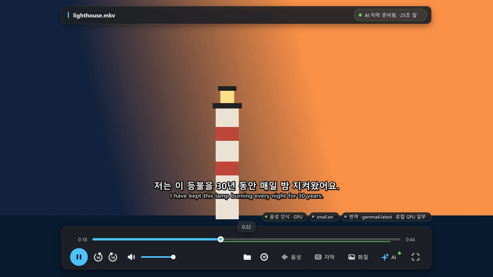

<div align="center">

# NanumPlayer

**내 언어로 영상을 보세요: 재생하는 동안 만들어지는 자막.**

NanumPlayer는 [mpv](https://mpv.io/) 기반의 Windows 영상 플레이어입니다. 대사를 듣고 Whisper로
인식한 뒤, 선택한 언어 모델로 번역해 자막 트랙으로 실시간으로 보여 줍니다. 로컬 파일, Blu-ray와 DVD,
YouTube·웹페이지 영상에 사용할 수 있습니다.

[English](README.md) · 한국어

[다운로드](https://github.com/kimmingul/NanumPlayer/releases/latest) ·
[웹사이트](https://kimmingul.github.io/NanumPlayer/) ·
[사용자 가이드](docs/ko/user-guide.md) ·
[변경 내역](CHANGELOG.md)

</div>



## 주요 기능

- **보면서 만드는 AI 자막.** 음성 인식([whisper.cpp](https://github.com/ggml-org/whisper.cpp), CPU 또는 NVIDIA GPU)이
  [Ollama](https://ollama.com)에서 실행되는 번역 모델(로컬 모델 또는 Ollama 클라우드 모델)에 입력을
  넘깁니다. NanumPlayer가 선읽기를 하므로 자막은 화면보다 조금 앞서 나타납니다.
- **기본은 내 언어.** 번역 목표 언어는 Windows 표시 언어로 시작하며 33개 언어 중에서 바꿀 수 있습니다.
  음성이 이미 그 언어면 번역하지 않습니다.
- **원어 음성 기반 두 번째 트랙.** 음성이 여러 언어인 영화에서는 재생 중인 음성으로 자막을 만들고,
  같은 읽기에서 낮은 우선순위로 원어 음성으로도 자막을 만듭니다. 자막 목록에서 원하는 쪽을 고르세요.
- **출처 배지가 붙은 하나의 자막 목록.** `[AI]`, `[원본 자막]`, `[파일]`, `[OCR]` 항목이 하나의 목록에
  함께 나옵니다. 목표 언어 자막이 이미 있으면 그대로 표시하고 AI 작업은 건너뜁니다.
- **자막 가져오기·찾기.** 자막 파일을 그대로 불러오거나, NanumPlayer가 음성에 맞춰 시간을 조정하고
  번역하게 할 수 있습니다. 메뉴에서 OpenSubtitles나 Jimaku를 검색할 수 있으며, 파일은 직접 받으면
  NanumPlayer가 가져옵니다.
- **재생 없이 자막 파일 만들기.** 음성 인식, 텍스트 자막 트랙, 이미지 자막 트랙(PGS, Windows OCR로
  읽음)에서 원문 언어 SRT와 언어별 번역 SRT를 하나씩 만듭니다.
- **용어집과 번역 말투.** 플레이어가 작품별 등장인물·고유명사 용어집을 만들고, 사용자가 고칠 수 있으며,
  고친 이름이 들어간 자막은 다시 번역합니다.
- **영상 화질과 GPU 업스케일.** 내장 보정 프리셋(노이즈 제거, 디밴딩, 선 강조, 선명화, 색 보정)은 작은
  GPU 셰이더 9개를 사용하며, 화질 버튼(또는 Ctrl+I)의 메뉴 하나에서 고품질 크기 조정,
  NVIDIA RTX Video Super Resolution, 사용자 mpv 셰이더를 고를 수 있습니다.
- **YouTube와 웹페이지.** 내장 브라우저 창에서 로그인하고 영상을 고르면 NanumPlayer가 영상을 재생하며
  AI 자막을 붙입니다. 이 창은 항상 InPrivate 모드로 실행되어 닫으면 기록이 남지 않습니다.
- **기본 비공개.** 켜지 않는 한 재생 로그, 기록, 번역 캐시, 충돌 덤프를 저장하지 않습니다.
  [개인정보](docs/ko/privacy.md)를 참고하세요.
- **Blu-ray와 DVD.** 디스크를 재생하고 제목을 무손실 MKV로 저장합니다. 복제 방지 디스크를 복호화하는
  구성 요소는 다운로드에 **포함되지 않습니다**. 이는
  [별도로 설치하는 선택 구성 요소](docs/ko/disc-components.md)이며 합법적으로 사용할 책임은 사용자에게
  있습니다.
- **여섯 가지 인터페이스 언어.** 한국어, 영어, 스페인어, 일본어, 중국어 간체, 중국어 번체를 설치 파일과
  브라우저 도우미까지 지원합니다.

## 스크린샷

| 영어 인터페이스 | 한국어 인터페이스 |
|---|---|
|  |  |
|  |  |

스크린샷에는 생성한 테스트 미디어만 나옵니다.

## 다운로드

[릴리스 페이지](https://github.com/kimmingul/NanumPlayer/releases/latest)에서 최신 릴리스를 받으세요.

| 파일 | 용도 |
|---|---|
| `NanumPlayer-Setup-<version>.exe` | 사용자 단위 설치 파일(모든 사용자용으로 설치하기로 선택하지 않는 한 관리자 권한이 필요 없음). 선택 다운로드를 제공합니다. |
| `NanumPlayer-<version>-portable.zip` | 포터블 폴더: 아무 곳에나 압축을 풀고 `NanumPlayer.exe`를 실행합니다. |
| `SHA256SUMS-<version>.txt` | 위 두 파일의 SHA-256 체크섬. |

실행하기 전에 다운로드한 파일을 확인하세요.

```powershell
Get-FileHash .\NanumPlayer-Setup-<version>.exe -Algorithm SHA256
```

**코드 서명과 SmartScreen.** 릴리스 설치 파일과 NanumPlayer 자체 바이너리(`NanumPlayer.exe`,
`nanum_youtube.exe`, `nanum_ai_cpu.dll`, `nanum_ai_cuda.dll`)는 *Nanum Space Co,. Ltd*에 발급된 코드 서명
인증서로 서명되어 있으며 RFC 3161 타임스탬프를 포함합니다. Windows SmartScreen은 서명과 파일이 얼마나
널리 다운로드되었는지를 보고 판단하므로, 새 릴리스는 여전히 "Windows의 PC 보호"를 표시할 수 있습니다.
표시된 게시자가 *Nanum Space Co,. Ltd*이고 SHA-256이 `SHA256SUMS`와 일치하면 **추가 정보 → 실행**을
선택하세요. 패키지에 들어 있는 서드파티 라이브러리는 각자의 서명 상태를 유지합니다.

음성 모델, CUDA 런타임, YouTube 도구, 디스크 복호화 구성 요소는 다운로드에 들어 있지 않습니다.
[무엇을 언제 다운로드하는지](docs/ko/privacy.md)를 참고하세요.

## 빠른 시작

1. **번역 서버 설치.** [Ollama](https://ollama.com)를 설치하고 실행해 모델이 하나 이상 있는지
   확인합니다(GPU에 맞는 로컬 모델 또는 Ollama 클라우드 모델).
2. **NanumPlayer 설치.** 설치 화면에서 원하는 음성 모델(예: *영어 음성 인식* 또는 *다국어 음성 인식*)을
   선택합니다. 선택하지 않으면 아무것도 다운로드하지 않습니다. 모델은 나중에
   **Ctrl+N → AI 구성 요소 관리**에서 받을 수 있습니다.
3. **영상 열기.** **파일 열기**(Ctrl+O)를 사용하거나, 파일을 창에 끌어 놓거나, 디스크를 열거나(Ctrl+D),
   **웹페이지에서 재생하기**를 선택합니다.
4. **번역 모델 선택.** **Ctrl+N → 번역 모델**을 눌러 Ollama 서버가 알려 주는 목록에서 모델을 고릅니다.
   언어를 바꾸려면 **Ctrl+N → 번역 목표 언어**를 누르세요.
5. **시청.** 처음 열 때 NanumPlayer는 재생보다 앞서 자막이 준비될 때까지 최대 30초 기다린 뒤
   재생합니다. **자막** 버튼을 열어 트랙을 고르세요.

영상에 알맞은 언어의 텍스트 자막 트랙이 이미 있다면 위 과정은 필요 없습니다. 그대로 표시됩니다.
텍스트 자막 트랙(내장 또는 외부)은 음성 모델이나 CUDA 없이도 번역할 수 있습니다.

전체 안내는 [사용자 가이드](docs/ko/user-guide.md)에 있습니다.

## 요구 사항

| | 필요 | 비고 |
|---|---|---|
| 운영 체제 | Windows 10 또는 11, x64 | |
| CPU | AVX2를 지원하는 x64 | CPU 음성 인식이 포함되어 있습니다. |
| 번역 | 모델이 있는 Ollama 호환 서버 | 로컬 또는 Ollama 클라우드; 별도 설치. 기본 모델 이름은 `gemma4:latest`이며 용량이 큽니다(12.8 GB). GPU에 맞는 모델이나 클라우드 모델을 고르세요. |
| 음성 모델 | Whisper + Silero VAD 파일 | 선택 다운로드(영어 또는 다국어는 약 466 MiB, 다국어 고정밀은 약 548 MiB). 텍스트 자막 번역에는 필요 없습니다. |
| NVIDIA GPU (선택) | compute capability 8.6 이상, 최신 드라이버 | CUDA 음성 인식용. CUDA 엔진은 포함되어 있으며 **CUDA 13 Toolkit**의 cuBLAS 또는 선택 cuBLAS 다운로드(약 507 MiB)가 필요합니다. |
| RTX 업스케일 (선택) | 지원되는 NVIDIA GPU와 드라이버 | NVIDIA 앱 또는 제어판에서 RTX Video Super Resolution을 켜세요. |
| YouTube / 웹 창 | WebView2 런타임 | 최신 Windows 11에는 기본 설치되어 있습니다. YouTube에는 yt-dlp와 Deno 도구(선택 다운로드)도 필요합니다. |
| 디스크 자막 OCR | Windows OCR 언어 팩 | 영어 자막에는 영어 팩이 한국어 팩보다 정확합니다. |
| omp를 이용한 전체 파일 번역 (선택) | `PATH`에 있는 [oh-my-pi](https://github.com/can1357/oh-my-pi)(`omp`) | `omp` 전체 번역 엔진에만 필요합니다. |

## 문서

| | |
|---|---|
| [사용자 가이드](docs/ko/user-guide.md) | 플레이어의 모든 기능을 단계별로 안내 |
| [선택 디스크 구성 요소](docs/ko/disc-components.md) | 선택 구성 요소란 무엇이며 어떻게 설치하는지, 법적 고지 |
| [개인정보](docs/ko/privacy.md) | 무엇을 저장하고, 무엇을 다운로드하며, 무엇이 PC 밖으로 나가는지 |
| [문제 해결](docs/ko/troubleshooting.md) | 흔한 문제와 알려진 한계 |
| [참조](docs/ko/reference.md) | 명령행 옵션, 속성, 명령 |
| [용어집](docs/glossary.md) | 영어 ↔ 한국어 용어 |
| [소스에서 빌드](docs/ko/building.md) | 툴체인, 빌드 단계, 패키징, 구조 |
| [검증 기록](docs/development/verification-history.md) | 무엇을 어떤 하드웨어에서 테스트했는지 |
| [변경 내역](CHANGELOG.md) | 릴리스 기록 |

가이드의 영어판은 [`docs/`](docs/)에 있습니다.

## 빌드

[docs/ko/building.md](docs/ko/building.md)를 참고하세요. 요약하면, 서브모듈과 함께 클론하고,
`tools\build_nanum_ai.bat`으로 AI 엔진을, `tools\build_youtube.bat`으로 브라우저 도우미를, MSYS2 CLANG64
셸에서 Meson으로 플레이어를 빌드한 뒤 `python tools/package.py`로 패키징합니다.

```bat
git clone --recurse-submodules https://github.com/kimmingul/NanumPlayer.git
```

## 기여와 지원

- 질문과 버그 제보: [이슈를 열어 주세요](https://github.com/kimmingul/NanumPlayer/issues/new/choose).
- 풀 리퀘스트를 환영합니다. 먼저 [CONTRIBUTING.md](CONTRIBUTING.md)를 읽어 주세요.
- 보안 문제: [SECURITY.md](SECURITY.md)를 참고하세요. 공개 이슈로 등록하지 마세요.
- 참여하는 모든 분은 [행동 강령](CODE_OF_CONDUCT.md)을 따릅니다.

## 라이선스

NanumPlayer는 자유 소프트웨어입니다. Free Software Foundation이 발표한 GNU General Public License의
버전 2 또는 (선택에 따라) 그 이후 버전의 조건에 따라 재배포하고 수정할 수 있습니다.
[LICENSE](LICENSE)를 참고하세요. 이 플레이어는 mpv의 수정 빌드이며, 여기서 빌드한 mpv는
GPL-2.0-or-later입니다. 서드파티 구성 요소는 각자의 라이선스를 유지합니다.
[THIRD_PARTY_NOTICES.md](THIRD_PARTY_NOTICES.md)를 참고하세요.

이 소프트웨어는 보증 없이 제공됩니다. 소프트웨어와 모든 선택 구성 요소를 사용하는 일은 사용자에게
적용되는 법률과, 함께 사용하는 서비스 및 미디어의 약관에 따라 사용할 책임이 사용자에게 있습니다.
