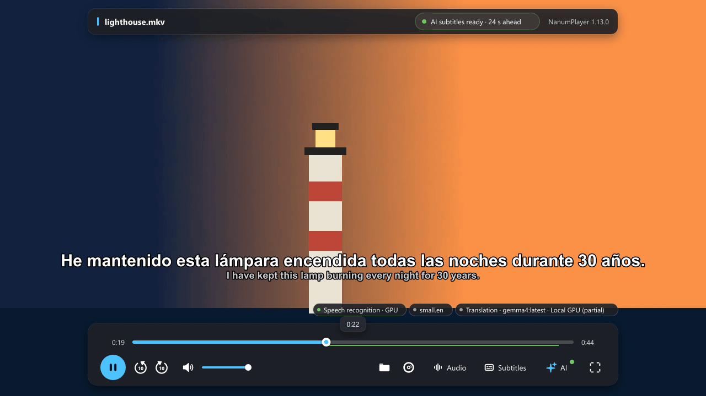
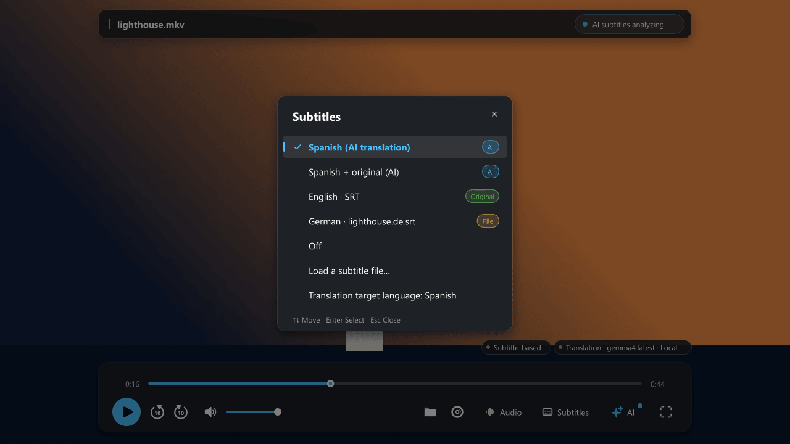
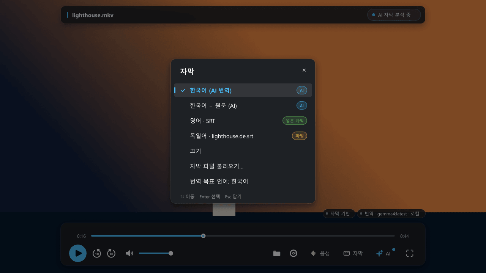
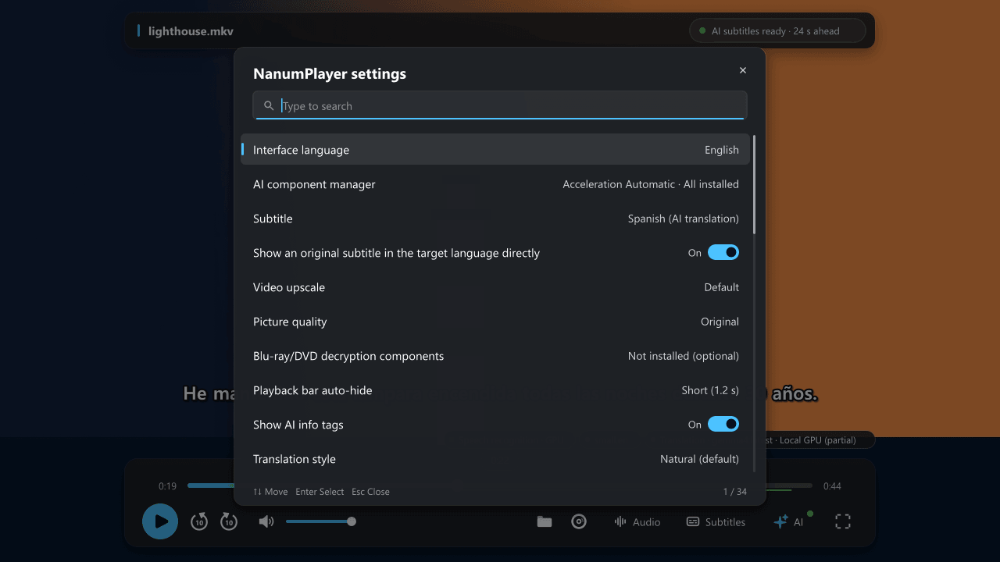
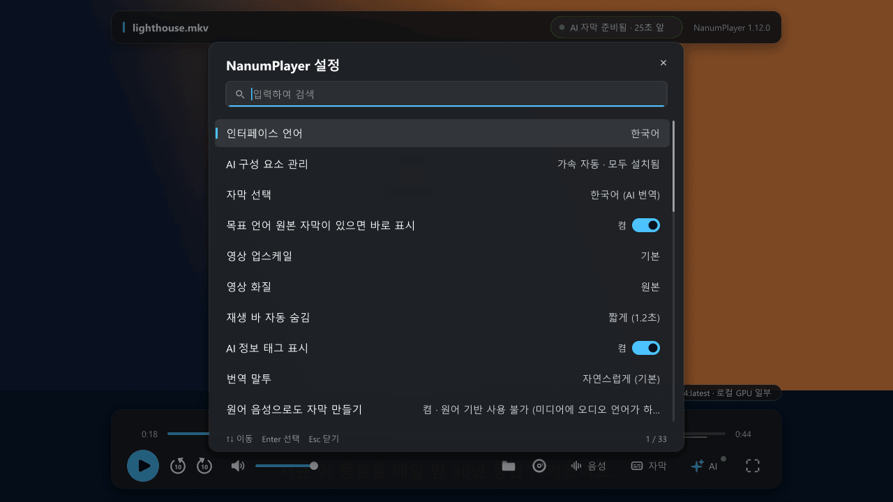

<div align="center">

# NanumPlayer

**Watch video in your own language: subtitles made while you play.**

NanumPlayer is a Windows video player built on [mpv](https://mpv.io/). It listens to the dialogue,
recognizes it with Whisper, translates it with the language model you choose and shows the result as a
subtitle track, in real time, for local files, Blu-ray and DVD, YouTube and web-page videos.

English · [한국어](README.ko.md)

[Download](https://github.com/kimmingul/NanumPlayer/releases/latest) ·
[Website](https://kimmingul.github.io/NanumPlayer/) ·
[User guide](docs/user-guide.md) ·
[Changelog](CHANGELOG.md)

</div>



## Highlights

- **AI subtitles while you watch.** Speech recognition ([whisper.cpp](https://github.com/ggml-org/whisper.cpp), on the CPU or on an NVIDIA GPU) feeds a translation model that runs in
  [Ollama](https://ollama.com) (local models or Ollama cloud models). Subtitles appear a little ahead of
  the picture because NanumPlayer reads ahead.
- **Your language by default.** The target language starts as your Windows display language and can be
  any of 33 languages. If the audio is already in that language, nothing is translated.
- **A second track from the original audio.** For a film with several audio languages, NanumPlayer
  makes subtitles from the audio you are playing and, at lower priority and from the same read, from the
  original-language audio. Choose either in the subtitle list.
- **One subtitle list with source badges.** `[AI]`, `[Original]`, `[File]` and `[OCR]` entries share a
  single list. A subtitle that already exists in your target language is shown as it is and the AI work
  is skipped.
- **Import or search subtitles.** Load a subtitle file as it is, or let NanumPlayer align it to the
  speech and translate it. Search OpenSubtitles or Jimaku from the menu; you download the file yourself
  and NanumPlayer picks it up.
- **Generate subtitle files without playing.** Make a source-language SRT plus one translated SRT per
  language from speech recognition, a text subtitle track or an image subtitle track (PGS, read with
  Windows OCR).
- **Glossary and translation style.** The player builds a per-work glossary of character and proper
  names, you can edit it, and edits re-translate the subtitles that contain the changed names.
- **Picture quality and GPU upscaling.** Built-in correction presets (denoise, deband, line
  enhancement, sharpening, color) use 9 small GPU shaders, and the Picture button (or Ctrl+I) opens one menu
  with high-quality scaling, NVIDIA RTX Video Super Resolution and your own mpv shaders.
- **YouTube and web pages.** Sign in and pick videos in a built-in browser window; NanumPlayer plays the
  video and adds the AI subtitles. These windows always use an InPrivate session.
- **Private by default.** No playback log, history, translation cache or crash dump is kept unless you
  turn it on. See [Privacy](docs/privacy.md).
- **Blu-ray and DVD.** Play discs and save titles to lossless MKV. The components that decrypt
  copy-protected discs are **not** part of the download: they are an
  [optional, separately installed component](docs/disc-components.md) that you are responsible for
  using lawfully.
- **Six interface languages.** Korean, English, Spanish, Japanese, Simplified Chinese and Traditional
  Chinese, including the installer and the browser helper.

## Screenshots

| English interface | Korean interface |
|---|---|
|  |  |
|  |  |

The screenshots show generated test media only.

## Download

Get the latest release from the [Releases page](https://github.com/kimmingul/NanumPlayer/releases/latest):

| File | Use |
|---|---|
| `NanumPlayer-Setup-<version>.exe` | Per-user installer (no administrator rights needed unless you choose to install for all users). Offers optional downloads. |
| `NanumPlayer-<version>-portable.zip` | Portable folder: unzip anywhere and run `NanumPlayer.exe`. |
| `SHA256SUMS-<version>.txt` | SHA-256 checksums of the two files above. |

Check the download before running it:

```powershell
Get-FileHash .\NanumPlayer-Setup-<version>.exe -Algorithm SHA256
```

**Code signing and SmartScreen.** Release installers and NanumPlayer's own binaries
(`NanumPlayer.exe`, `nanum_youtube.exe`, `nanum_ai_cpu.dll`, `nanum_ai_cuda.dll`) are signed with a code-signing
certificate issued to *Nanum Space Co,. Ltd* and carry an RFC 3161 timestamp. Windows SmartScreen decides
from the signature and from how widely a file has been downloaded, so a new release can still show
"Windows protected your PC". If the publisher shown is *Nanum Space Co,. Ltd* and the SHA-256 matches
`SHA256SUMS`, choose **More info → Run anyway**. Third-party libraries in the package keep their own
signature state.

Speech models, the CUDA runtime, the YouTube tools and the disc decryption component are not in the
download. See [what is downloaded, and when](docs/privacy.md#what-the-player-downloads-and-contacts).

## Quick start

1. **Install a translation server.** Install [Ollama](https://ollama.com), start it and make sure it has
   at least one model (a local model that fits your GPU, or an Ollama cloud model).
2. **Install NanumPlayer.** In the installer, tick the speech model you want (for example *English
   speech recognition* or *Multilingual speech recognition*). Nothing is downloaded unless you tick it. You can download
   models later with **Ctrl+N → AI component manager**.
3. **Open a video.** Use **Open file** (Ctrl+O), drag a file into the window, open a disc (Ctrl+D) or
   choose **Play from a web page**.
4. **Pick the translation model.** Press **Ctrl+N → Translation model** and choose a model from the list
   your Ollama server reports. Press **Ctrl+N → Translation target language** to change the language.
5. **Watch.** On the first open NanumPlayer waits up to 30 seconds until subtitles are ready ahead of
   playback, then plays. Open the **Subtitles** button to choose a track.

If a video already has a text subtitle track in the right language, you need none of the above: it is
shown as it is. Text subtitle tracks (embedded or external) can also be translated without a speech
model and without CUDA.

The full walkthrough is in the [user guide](docs/user-guide.md).

## Requirements

| | Required | Notes |
|---|---|---|
| Operating system | Windows 10 or 11, x64 | |
| CPU | x64 with AVX2 | CPU speech recognition is included. |
| Translation | An Ollama-compatible server with a model | Local or Ollama cloud; installed separately. `gemma4:latest` is the default model name and is large (12.8 GB); choose a model that fits your GPU, or a cloud model. |
| Speech models | Whisper + Silero VAD files | Optional download (about 466 MiB for English or Multilingual, about 548 MiB for Multilingual high accuracy). Not needed for text-subtitle translation. |
| NVIDIA GPU (optional) | Compute capability 8.6 or newer, a current driver | For CUDA speech recognition. The CUDA engine is bundled; it needs cuBLAS from a **CUDA 13 Toolkit** or the optional cuBLAS download (about 507 MiB). |
| RTX upscaling (optional) | A supported NVIDIA GPU and driver | Enable RTX Video Super Resolution in the NVIDIA app or control panel. |
| YouTube / web windows | WebView2 Runtime | Preinstalled on current Windows 11. YouTube also needs the yt-dlp and Deno tools (optional download). |
| Disc subtitle OCR | A Windows OCR language pack | The English pack gives better accuracy than the Korean one for English subtitles. |
| Whole-file translation with omp (optional) | [oh-my-pi](https://github.com/can1357/oh-my-pi) (`omp`) on `PATH` | Only for the `omp` full-translation engine. |

## Documentation

| | |
|---|---|
| [User guide](docs/user-guide.md) | Everything the player can do, step by step |
| [Optional disc components](docs/disc-components.md) | What the optional component is, how to install it, legal notice |
| [Privacy](docs/privacy.md) | What is stored, what is downloaded, what leaves your PC |
| [Troubleshooting](docs/troubleshooting.md) | Common problems and known limitations |
| [Reference](docs/reference.md) | Command-line options, properties and commands |
| [Glossary](docs/glossary.md) | English ↔ Korean terminology |
| [Building from source](docs/building.md) | Toolchain, build steps, packaging, architecture |
| [Verification history](docs/development/verification-history.md) | What was tested, on what hardware |
| [Changelog](CHANGELOG.md) | Release history |

Korean versions of the guides are in [`docs/ko/`](docs/ko/).

## Building

See [docs/building.md](docs/building.md). In short: clone with submodules, build the AI engines with
`tools\build_nanum_ai.bat`, the browser helper with `tools\build_youtube.bat`, the player with Meson
from an MSYS2 CLANG64 shell, and package with `python tools/package.py`.

```bat
git clone --recurse-submodules https://github.com/kimmingul/NanumPlayer.git
```

## Contributing and support

- Questions and bug reports: [open an issue](https://github.com/kimmingul/NanumPlayer/issues/new/choose).
- Pull requests are welcome; read [CONTRIBUTING.md](CONTRIBUTING.md) first.
- Security problems: see [SECURITY.md](SECURITY.md); do not file them as public issues.
- Everyone taking part follows the [Code of Conduct](CODE_OF_CONDUCT.md).

## License

NanumPlayer is free software: you can redistribute it and modify it under the terms of the GNU General
Public License as published by the Free Software Foundation, either version 2 of the License or (at your
option) any later version. See [LICENSE](LICENSE). The player is a modified build of mpv, which is
GPL-2.0-or-later as built here. Third-party components keep their own licenses; see
[THIRD_PARTY_NOTICES.md](THIRD_PARTY_NOTICES.md).

The software is provided without warranty. You are responsible for using it, and any optional
component, in accordance with the law that applies to you and with the terms of the services and media
you use it with.
